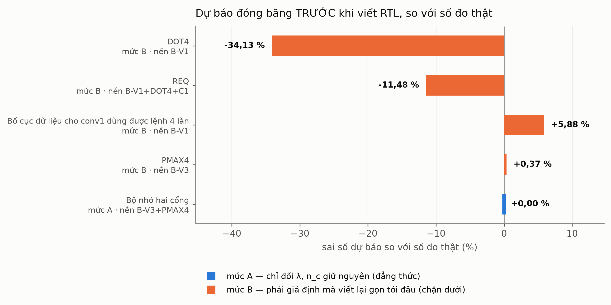
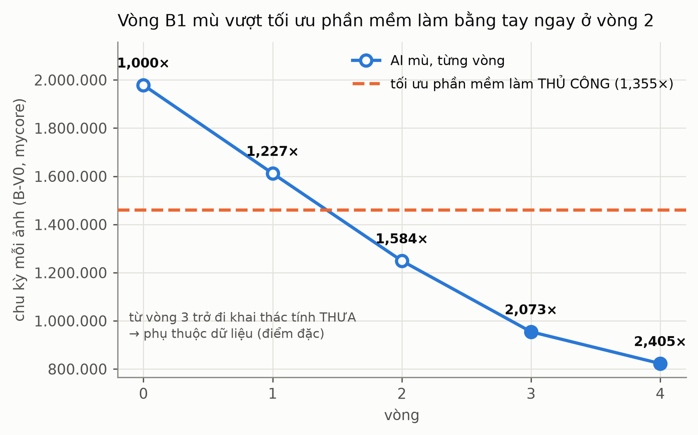
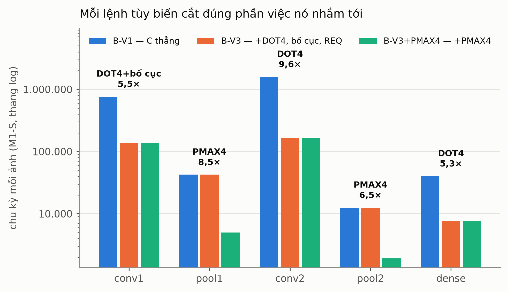
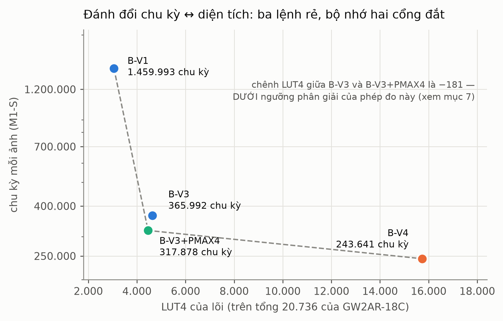
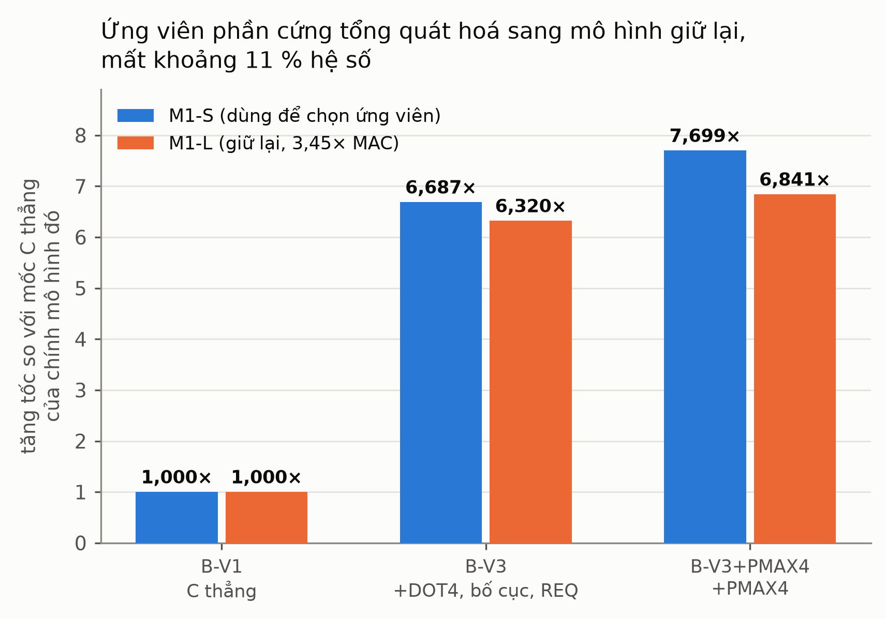

# Kết quả pipeline đồng thiết kế có AI hỗ trợ (S0 → S9)

**Ngày**: 2026-10-18 · **Kit**: Sipeed Tang Nano 20K (GW2AR-LV18QN88C8/I7), 27 MHz cố định
**Mô hình chính**: M1-S (CNN int8, MNIST, 192.064 MAC) · **Mô hình giữ lại**: M1-L (662.912 MAC)
Kế hoạch: `docs/PIPELINE_PLAN.md` · Đặc tả: `docs/PIPELINE_SPEC.md` · Kết quả thô: `results/pipeline/S*/`
Biểu đồ: `report/pipeline/` · Bảng 16 cấu hình đo trên kit: `docs/KET_QUA_TONG_HOP.md`

---

## 0. Một đoạn tóm tắt

Pipeline đi từ **mã C thẳng + lõi RISC-V gốc** tới **lõi có ba lệnh tùy biến và bộ nhớ hai cổng**,
tự đề xuất các thay đổi phần cứng ở **chế độ mù** (không được xem lịch sử dự án), tự **dự báo trước
khi hiện thực**, rồi đo trên **phần cứng thật**. Từ 332,9 ms xuống **9,0 ms — 36,89×** trên cùng
một FPGA, cùng một xung nhịp, mọi lớp vẫn đúng từng bit so với golden Python.

Ba kết quả đáng kể nhất:

1. **Dự báo mức A đúng tuyệt đối.** Dự báo 243.641 chu kỳ đóng băng trước khi viết một dòng RTL;
   Verilator 243.641; kit 243.641. **Sai số 0,00 %.**
2. **AI mù vượt tối ưu phần mềm làm bằng tay** ngay ở vòng 2 (1,584× so với 1,355×), và đạt 2,405×
   ở vòng 4.
3. **Mô hình λ không thấy hai loại giá quan trọng nhất**: diện tích và dung lượng. Ứng viên dự báo
   chu kỳ chính xác nhất cũng là ứng viên đắt nhất về LUT (×3,5) và là ứng viên **loại bỏ khả năng
   chạy mô hình lớn hơn**.

---

## 1. PQ1 — ISS và mô hình chu kỳ dự báo chính xác đến đâu?

Tách làm hai câu hỏi khác nhau, vì chúng có câu trả lời rất khác nhau.

### 1.1 ISS tái lập số đo: tuyệt đối

| | số cấu hình | kết quả |
|---|---:|---|
| mycore, chu kỳ ISS = Verilator từng lớp từng ảnh | 8 | **bằng tuyệt đối, 0,0 %** |
| PicoRV32, tiêu chí kế hoạch ≤ 2 % | 6 | **bằng tuyệt đối, 0,0 %** — vượt xa tiêu chí |
| CRC 5 tensor ISS = golden Python | 14 | **khớp hết** |

Phép kiểm K1 của mô hình chi phí (`n_c` suy ra từ cấu trúc = `n_c` đếm bởi ISS): **20/20 hàng khớp,
0 hàng sai**. Nguồn: `results/pipeline/S2/`.

### 1.2 Dự báo TRƯỚC khi hiện thực: phụ thuộc hẳn vào TẦNG

Đây mới là câu hỏi khó. Mô hình chi phí `C = Σ n_c·λ_c` chia dự báo làm ba mức
(`docs/MO_HINH_CHI_PHI.md`), và sai số thật bám đúng theo mức:

| ứng viên | mức | dự báo | đo thật | sai số |
|---|---|---:|---:|---:|
| Bộ nhớ hai cổng (trên B-V3+PMAX4) | **A** | 243.641 | 243.641 | **0,00 %** |
| PMAX4 (trên B-V3) | B | 316.695 | 317.878 | **+0,37 %** |
| Bố cục 4 pha cho conv1 | B | 460.778 | 487.865 | +5,88 % |
| REQ | B | 413.468 | 365.992 | −11,48 % |
| DOT4 | B | 958.121 | 631.130 | −34,13 % |

**Mức A là đẳng thức, không phải ước lượng.** Ứng viên không sửa một dòng mã nào, nên `n_c` giữ
nguyên từng con số (`instret` giống hệt 236.313) và `ΔC = Σ n_c·Δλ_c` đúng theo định nghĩa. Số đo
xác nhận: 0,00 %.

**Mức B phải giả định mã sẽ được viết lại gọn tới đâu**, nên nó là **chặn dưới của tăng tốc**, và
sai số âm lớn (DOT4 −34 %) có nghĩa **thực tế tốt hơn dự báo**, không phải mô hình sai. Hai ứng
viên gần nhất với thực tế (PMAX4 +0,37 %, bố cục +5,88 %) là hai ứng viên mà phần mã viết lại hẹp
và dễ đoán; hai ứng viên lệch nhiều (REQ, DOT4) là hai ứng viên làm đổi cả cách tổ chức vòng lặp.

**Trả lời PQ1**: ISS tái lập phần cứng **tuyệt đối**. Dự báo trước-khi-làm chính xác **tới 0,00 %
ở mức A**, và ở mức B là **chặn dưới đáng tin trong khoảng −34 % … +6 %** — đủ để xếp hạng ứng
viên, không đủ để hứa một con số.

---

## 2. PQ2 — Vòng B1 có AI tái khám phá được tối ưu phần mềm thủ công không?

Điểm xuất phát: kernel C thẳng (B-V0, 1.978.697 chu kỳ). Subagent chạy trong **hộp cát mù** — thư
mục làm việc nằm NGOÀI cây dự án nên không nạp `CLAUDE.md`, không thấy docs, không thấy bản tối ưu
thủ công. Mỗi vòng đề xuất 3 biến thể, giữ biến thể đúng-bit nhanh nhất.

| vòng | chu kỳ | so B-V0 | cải thiện | ghi chú |
|---:|---:|---:|---:|---|
| 0 | 1.978.697 | 1,000× | — | mốc C thẳng |
| 1 | 1.612.135 | 1,227× | 18,5 % | |
| 2 | **1.249.201** | **1,584×** | 22,5 % | **đã vượt bản thủ công (1,355×)** |
| 3 | 954.673 | 2,073× | 23,6 % | bắt đầu khai thác tính thưa → phụ thuộc dữ liệu |
| 4 | 822.796 | 2,405× | 13,8 % | dừng theo quyết định người dùng, **chưa bão hoà** |

**12/12 ứng viên đúng từng bit**; Verilator xác nhận bằng tuyệt đối.

**Trả lời PQ2**: **vượt, không chỉ tái khám phá.** Bản không phụ thuộc dữ liệu đạt **1,584×** so với
**1,355×** của bản làm bằng tay. Nếu tính cả bản khai thác tính thưa thì **2,405×**, nhưng bản đó
**phụ thuộc đầu vào** (biên độ 13,7 % giữa các ảnh) nên không so sánh trực tiếp được — đây là một
khác biệt về *loại* kết quả, không phải về *mức* kết quả, và phải nói rõ.

Đường cong vẫn đang dốc khi dừng: ba vòng đầu đều cải thiện trên 18 %.

---

## 3. PQ3 — B2 mù có tái khám phá DOT4, REQ, bố cục, vi kiến trúc không?

Subagent chỉ được cấp `analysis.json` của firmware A-V1 chạy trên lõi mycore gốc (B-V1), cùng danh
sách biến đổi được phép. Không docs, không lịch sử, không tên lệnh.

| lần chạy | chế độ | ứng viên | tầng phủ | tái khám phá |
|---|---|---:|---:|---|
| 1 | mù, KHÔNG catalog | 12 | 5/5 | DOT4 · bộ nhớ nhanh · bố cục · **REQ** |
| 2 | mù, KHÔNG catalog | 12 | 5/5 | DOT4 · bộ nhớ nhanh · bố cục |
| 3 | mù, KHÔNG catalog | 12 | 5/5 | DOT4 · bộ nhớ nhanh |
| 4 | mù, CÓ catalog | 12 | 5/5 | DOT4 · bộ nhớ nhanh · bố cục · **REQ** |
| 5 | mù, CÓ catalog | 12 | 5/5 | DOT4 · bộ nhớ nhanh · bố cục · **REQ** |
| 6 | mù, CÓ catalog | 12 | 5/5 | DOT4 · bộ nhớ nhanh · bố cục · **REQ** |

**Trả lời PQ3**: **có.** DOT4 và "bộ nhớ nhanh hơn" được tìm lại ở **6/6 lần chạy**; bố cục 5/6;
REQ 4/6. Không lần nào bỏ sót cả bốn.

Đáng chú ý: ứng viên **"tách cổng nạp lệnh khỏi cổng dữ liệu (Harvard), λ_load 2→1"** xuất hiện ngay
ở lần chạy mù đầu tiên — và đó chính là ứng viên về sau được hiện thực ở S7 thành B-V4, với dự báo
đúng 0,00 %. Tức **pipeline tự đề xuất đúng thứ mà về sau nó dự báo chính xác nhất.**

**Độ ổn định**: chế độ **có catalog** tái khám phá đủ cả 4 ở **3/3 lần**; chế độ **không catalog**
chỉ 1/3. Catalog làm việc tái khám phá ổn định hơn hẳn — phải báo cáo riêng vì nó là mồi, dù nó chỉ
chứa mẫu chung chứ không chứa đáp án của dự án này.

---

## 4. PQ4 — AI so với bộ sinh theo luật

| | ứng viên | tầng phủ | tái khám phá | ứng viên MỚI (chưa ai làm) |
|---|---:|---:|---|---:|
| AI mù (mỗi lần chạy) | 12 | 5/5 | tới 4/4 | tới 34 trên 6 lần chạy |
| theo luật | 6 | 4/5 | 3/4 (thiếu REQ) | 0 |

Bộ sinh theo luật là hàm thuần tuý của `analysis.json`: nó đề xuất đúng những gì luật đã viết sẵn,
nên nó **không bao giờ đề xuất thứ chưa có luật** — đó vừa là điểm mạnh (lặp lại được 100 %) vừa là
trần của nó. REQ nằm ngoài tầm vì nó đòi nhận ra rằng *một chuỗi số học* có thể gộp thành một lệnh.

**Trả lời PQ4**: trên cùng một đầu vào, AI cho **gấp đôi số ứng viên**, phủ thêm một tầng, tìm thêm
REQ, và sinh **34 ứng viên mới** mà luật không có. Giá phải trả là **không tất định**: ba lần chạy
cùng một chế độ cho ba tập tái khám phá khác nhau.

**Chi phí AI đo được**: S5 — **5 lời gọi, 34,0 phút tường** (ghi trong `results/pipeline/S5/ai_calls/`).
S4 — 4 vòng × 3 ứng viên, khoảng **1 giờ tường** (suy từ dấu thời gian thư mục run). Mọi lời gọi
chạy trong tiến trình riêng, thư mục NGOÀI cây dự án, có ghi `prompt_sha256` để kiểm lại.

---

## 5. PQ5 — Ứng viên mới đem lại thêm bao nhiêu trên B-V3?

Hai ứng viên chưa từng ai làm trong dự án này đã được hiện thực trọn vẹn và **đo trên kit**:

| | chu kỳ | so B-V3 | ms | ảnh/s | giá LUT4 |
|---|---:|---:|---:|---:|---|
| B-V3 (mốc) | 365.992 | 1,000× | 13,6 | 73,8 | — |
| **+ PMAX4** | 317.878 | **1,151×** | 11,8 | 84,9 | **không đo nổi** (\|Δ\| < 200) |
| **+ bộ nhớ hai cổng** | **243.641** | **1,502×** | **9,0** | **110,8** | **+11.277** (×3,5) |

Mỗi lệnh cắt đúng phần việc nó nhắm tới và gần như không đụng phần còn lại: DOT4 cắt conv2 **9,6×**,
PMAX4 cắt pool1 **8,5×** và pool2 **6,5×**, còn conv thì PMAX4 không đụng tới.

**Trả lời PQ5**: thêm **1,502×** so với B-V3 — từ 13,6 ms xuống **9,0 ms**, tức tổng **36,89×** so
với mốc A-V0 ban đầu. Nhưng hai ứng viên đó **khác hẳn nhau về giá diện tích** — và việc đo giá đó lại làm lộ một
giới hạn của chính phương pháp, xem mục 7.3.

---

## 6. PQ6 — Tính tổng quát trên mô hình giữ lại

M1-L = gấp đôi kênh, **662.912 MAC = 3,45× M1-S**, int8 98,79 %. Nó **chưa từng tham gia** việc chọn
ứng viên, và chạy qua **đúng** script huấn luyện, **đúng** script lượng tử hoá, **đúng** golden,
**đúng** `main.c`, **đúng** bộ kernel của M1-S — không một nhánh mã riêng.

| bước | M1-S | M1-L (giữ lại) | chênh |
|---|---:|---:|---:|
| DOT4 + bố cục 4 pha + REQ | 6,687× | 6,320× | −5,5 % |
| thêm PMAX4 | 1,151× | 1,082× | −6,0 % |
| **tổng** | **7,699×** | **6,841×** | **−11,1 %** |

Trên kit: M1-L ở B-V3+PMAX4 cho **1.116.402 chu kỳ = 41,3 ms = 24,2 ảnh/s**, đúng từng bit,
2/2 lượt đọc.

**Trả lời PQ6**: các ứng viên **tổng quát hoá**, mất khoảng **11 %** hệ số. Lý do đọc thẳng từ phân
rã lớp: gấp đôi kênh làm conv2 nặng **gấp 4** (C1×C2) nhưng pooling chỉ **gấp 2** (theo activation),
nên phần việc PMAX4 chạm tới co từ 15 % xuống 9 % tổng.

> **Giá trị của một ứng viên phần cứng phụ thuộc TỶ LỆ PHÉP TOÁN của mô hình, không phụ thuộc kích
> thước mô hình.**

---

## 7. Ba loại giá, và mô hình λ chỉ thấy một

Đây là kết luận mà tôi cho là có giá trị nhất của cả pipeline, và nó chỉ lộ ra vì có cả một ứng
viên rẻ lẫn một ứng viên đắt, cộng một mô hình thứ hai.

| loại giá | mô hình λ thấy? | PMAX4 | bộ nhớ hai cổng |
|---|---|---|---|
| **chu kỳ** | **có** — dự báo sai 0,37 % / **0,00 %** | −13,2 % chu kỳ | −23,4 % chu kỳ |
| **diện tích** | **không** | **nhỏ hơn ngưỡng đo được** | **+11.277 LUT4 (×3,5)** |
| **dung lượng** | **không** | không đổi | **RAM 64 → 32 KB** |

Giá thứ hai đã được ghi là giới hạn **trước khi đo** trong `docs/MO_HINH_CHI_PHI.md`, rồi đo thành
con số ở S7: cổng ghi thứ hai của tệp thanh ghi chiếm **77 %** chi phí LUT, vì nó phá mất khả năng
map tệp thanh ghi vào 32 khối `RAM16SDP4` (RAM phân tán của GW2A).

Giá thứ ba chỉ lộ ra ở S8: BSRAM hai cổng của GW2AR mất một nửa mật độ, nên B-V4 chỉ có **32 KB**
RAM, mà M1-S đã chiếm **96,4 %** của ngần ấy. **Không mô hình nào lớn hơn M1-S chạy được trên cấu
hình nhanh nhất.** Một mô hình λ chỉ đếm chu kỳ sẽ xếp bộ nhớ hai cổng là ứng viên tốt nhất; đo đủ
ba loại giá thì PMAX4 thắng áp đảo dưới ngân sách chặt.

**Hướng gỡ đã ghi, chưa làm**: Harvard tách hẳn — 32 KB bộ nhớ lệnh + 32 KB bộ nhớ dữ liệu, mỗi bên
BSRAM một cổng. Lấy được λ_load = 1 mà không cần BSRAM hai cổng, tổng vẫn 64 KB.

### 7.3 Và giá diện tích của một lệnh NHỎ thì phương pháp này không đo nổi

Ở bước S9 tôi tổng hợp lại ba cấu hình trên **cùng một bản RTL, cùng một firmware**, khác nhau
**đúng một tham số** — đúng cách mà S6 đã tự đặt ra để tránh bẫy so LUT giữa hai lần tổng hợp
khác nhau. Kết quả:

    bật WITH_PMAX4 (0 → 1):   LUT4  4.640 → 4.459   =  −181

Tức **thêm một lệnh lại TỐN ÍT LUT HƠN** — trong khi S6 đo đúng lệnh đó, đúng kiểu cặp A/B, trên
bản RTL thời điểm ấy, ra **+148**.

Không phải ngẫu nhiên: tổng hợp **tất định** khi tham số giống nhau. Ba lần dựng độc lập cho cùng
bộ tham số, ở ba thư mục khác nhau, với **ba firmware khác nhau**, đều cho **đúng 4.459 LUT4**.
Nên nội dung firmware không ảnh hưởng, và luồng lặp lại được.

Nguyên nhân là: đổi một tham số **đổi netlist**, và với một lệnh nhỏ như PMAX4, phần logic nó
thêm vào **cùng bậc độ lớn** với mức xê dịch do đóng gói lại.

> **Chi phí LUT của một lệnh nhỏ không đo được bằng một cặp A/B duy nhất.** Với PMAX4,
> |Δ| < 200 LUT4 (dưới 1 % chip) và **dấu còn không ổn định** giữa hai bản RTL.

**Hai con số bị rút lại**: "PMAX4 tốn +148 LUT4" và "PMAX4 tốn 9,8 LUT4 cho mỗi 1 % tăng tốc".
**Hai con số được giữ**: "+11.277 LUT4 (×3,5)" của bộ nhớ hai cổng và "+8.724 LUT4 của riêng cổng
ghi thứ hai" — chúng lớn gấp khoảng **60 lần** dải nhiễu.

Kết luận định tính **không đổi, và còn mạnh hơn**: PMAX4 rẻ tới mức **không đo nổi**; bộ nhớ hai
cổng đắt tới mức không thể nhầm. Điều phải bỏ là việc gán cho PMAX4 một con số diện tích cụ thể.
Muốn con số có nghĩa thì phải tổng hợp **riêng khối**, hoặc lấy trung vị trên nhiều bản RTL.

---

## 8. Điều pipeline làm được và điều nó KHÔNG làm được

Phần này cố ý viết cân bằng; một báo cáo chỉ kể phần thắng thì không dùng được.

**Làm được**
- Tái lập tuyệt đối: ISS = Verilator = kit, từng lớp từng ảnh, trên 16 cấu hình.
- Tự đề xuất ở chế độ mù những thứ con người đã nghĩ ra, cộng thứ con người chưa làm.
- Dự báo trước-khi-làm đủ tốt để **xếp hạng** ứng viên, và chính xác tuyệt đối ở mức A.
- Giữ kỷ luật bằng chứng: mọi dòng vào bảng chính đều có CRC 5 tensor, kit = Verilator tuyệt đối,
  2/2 lượt đọc độc lập và chốt dấu vân tay nguồn.

**Không làm được**
- **Không dự báo được diện tích.** Mọi con số LUT đều phải chạy tổng hợp mới biết; ×3,5 của bộ nhớ
  hai cổng là một bất ngờ hoàn toàn.
- **Không tất định.** Ba lần chạy cùng một chế độ mù cho ba tập ứng viên khác nhau.
- **Không tự biết điểm dừng.** Vòng B1 dừng vì người dùng bảo dừng, không phải vì bão hoà.
- **Không thay được phán đoán kỹ thuật.** Việc chọn top-K, việc nhận ra bẫy "so LUT giữa hai lần
  tổng hợp khác nhau", việc đòi một run sạch thay vì bằng chứng rải rác — đều do người làm.

---

## 9. Mốc thời gian và chi phí

| bước | nội dung | kết quả |
|---|---|---|
| S0–S1 | khung `cdp`, sổ cái, khoá kit; tái lập 3 cấu hình | bằng tuyệt đối |
| S2 | ISS RV32IM + mô hình chu kỳ | 14/14 cấu hình, 0,0 % |
| S3 | profile 3 tầng + phân tích | đẳng thức phân loại khớp |
| S4 | vòng B1 mù | 1,584× (vượt thủ công 1,355×) |
| S5 | sinh ứng viên mù | 6 lần chạy, tái khám phá 4/4 |
| S6 | phễu dự báo → đo kit; PMAX4 | sai 0,37 %, 28,27× |
| S7 | bộ nhớ hai cổng | **sai 0,00 %**, 36,89× |
| S8 | mô hình giữ lại M1-L | tổng quát hoá, −11 % |
| S9 | báo cáo này | — |

---

## 10. Tệp

| | |
|---|---|
| `results/pipeline/S*/README.md` | kết quả và log thô từng bước |
| `report/pipeline/*.png`, `*.pdf` | biểu đồ (PNG 300 dpi và PDF vector) |
| `scripts/s9_figures.py` | script sinh biểu đồ, mọi số đọc từ tệp kết quả |
| `docs/KET_QUA_TONG_HOP.md` | bảng 16 cấu hình đo trên kit |
| `docs/MO_HINH_CHI_PHI.md` | mô hình chi phí, ba mức dự báo, các giới hạn ghi TRƯỚC |
| `docs/LOG.md` | nhật ký từng phiên, gồm cả những lần sai và cách sửa |
